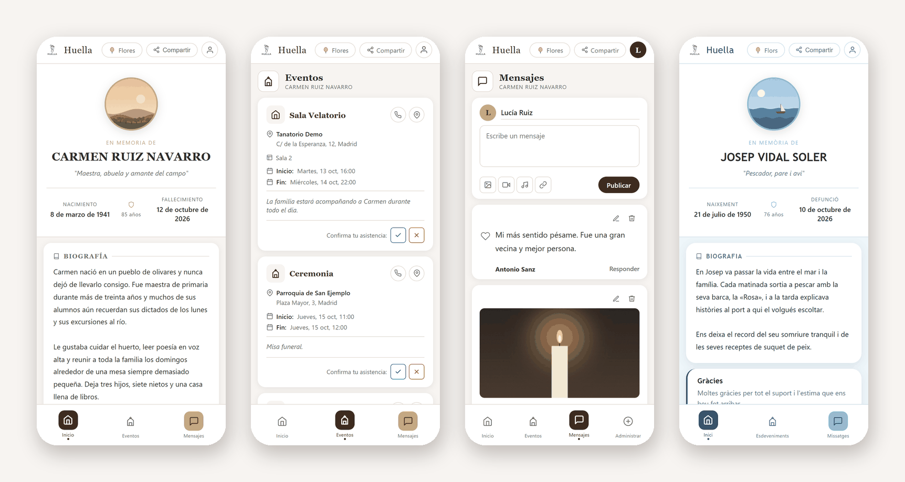
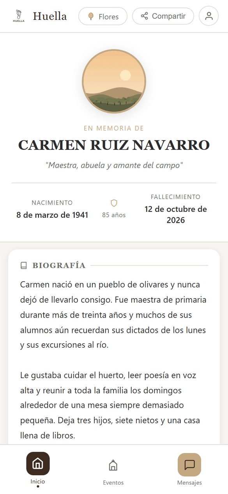
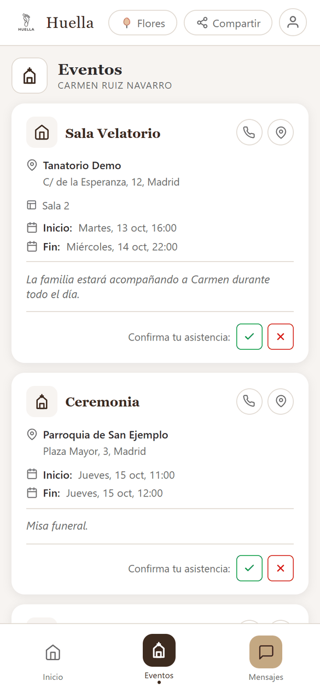
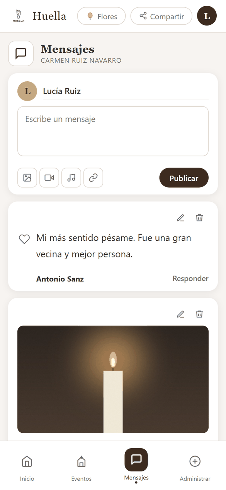
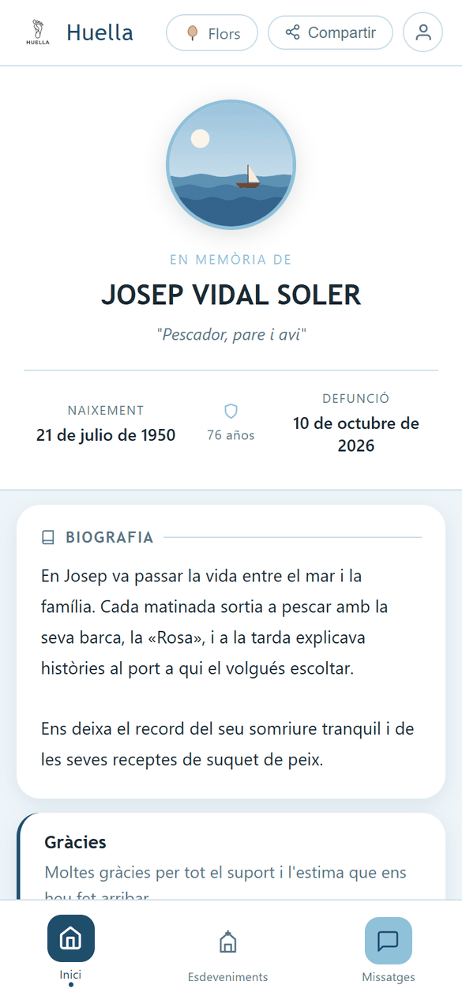
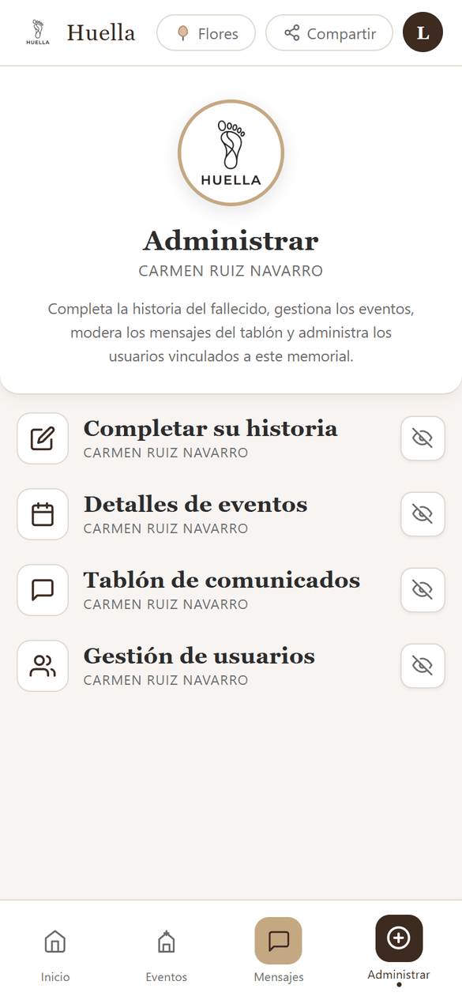
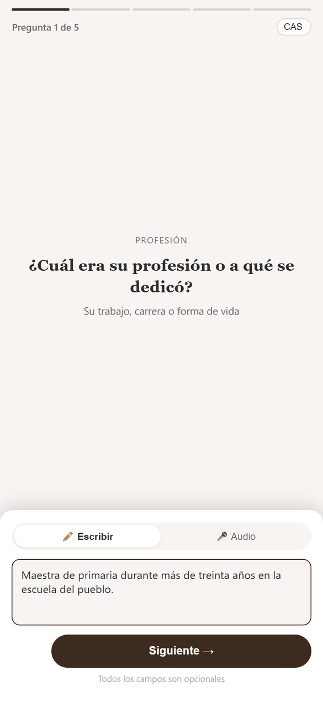
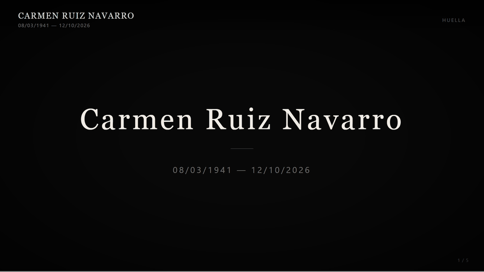
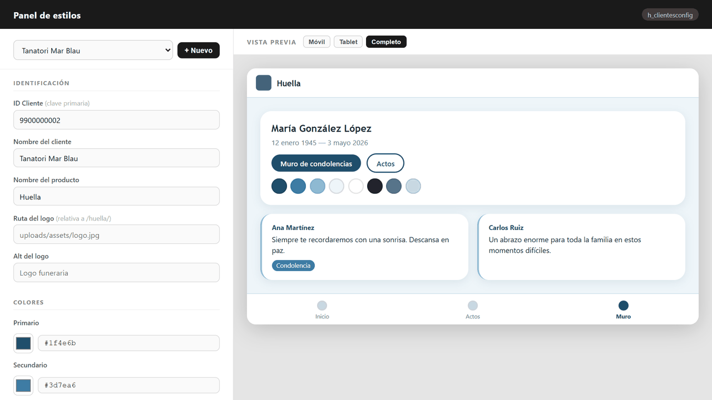

# Huella

Multi-tenant digital memorial platform for funeral homes, built with PHP 8, MySQL and vanilla JavaScript.

Each memorial ("huella") shows the obituary and biography of the deceased, the funeral services with RSVP, and a condolence wall where visitors can leave messages with photos, videos, audio or links. Funeral homes get their own visual theme, and a TV mode displays the wall on the screens of the funeral home.

> **Status:** prototype developed in 2026 and presented to a company in the funeral sector. It runs locally on XAMPP and is not deployed.



## Features

- **Multi-tenant:** client (funeral home) → company → branch, with a visual theme per client (CSS variables editable from a style panel).
- **4 languages:** Spanish, Catalan, English and Basque (`config/lang/*.json`).
- **Funeral services** (wake, ceremony, cremation, burial…) with attendance confirmation.
- **Condolence wall** with images, videos, audio and links, likes, replies, moderation and a profanity filter.
- **Roles:** owner, admin, collaborator, client, guest and applicant.
- **TV mode** (`tv.php`): slideshow of wall messages for the funeral home screens.
- **AI features:**
  - A biography assistant with voice input (Whisper speech-to-text and Llama 3.3, both through Groq).
  - Thank-you messages generated from the wall's messages.
- **Clean URLs** with Apache `mod_rewrite`, for example `/huella/{slug}/muro`.

## Screenshots

All data shown is fictitious demo data (`database/seed.sql`).

| Memorial | Funeral services | Condolence wall |
|---|---|---|
|  |  |  |

| Second client: own theme, in Catalan | Admin area | AI biography assistant |
|---|---|---|
|  |  |  |

**TV mode** for the screens of the funeral home: a slideshow of the wall messages.



**Style panel**, where each funeral home gets its own colours, fonts and logo, with a live preview:



## Tech stack

PHP 8 (strict types, prepared statements) · MySQL / MariaDB · vanilla JS · Apache · Groq API (Llama 3.3, Whisper) · Gemini / Anthropic (optional)

## Getting started (XAMPP)

1. Clone the repo into `htdocs/huella`. The routes currently assume the `/huella/` base path.
2. Create the database and load the schema and reference data:
   ```bash
   mysql -u root -e "CREATE DATABASE huellas CHARACTER SET utf8mb4"
   mysql -u root huellas < database/schema.sql
   mysql -u root huellas < database/reference_data.sql
   mysql -u root huellas < database/seed.sql      # optional: fictitious demo data
   ```
   The demo creates two funeral homes and two memorials:
   - `http://localhost/huella/carmen-ruiz-navarro`, in Spanish with a warm theme.
   - `http://localhost/huella/josep-vidal-soler`, in Catalan with a blue theme.

   Admin login for both: **`demo@huella.test` / `demo1234`**. Demo images live in `public/uploads/demo/`.
3. Database credentials default to XAMPP's (`root` with no password). To change them, set the `DB_HOST`, `DB_USER`, `DB_PASS` and `DB_NAME` environment variables.
4. AI keys (optional). Without them, the AI features return a "not configured" message.
   - **Groq:** set `GROQ_API_KEY`, or copy `config/groq.example.php` to `config/groq.php` and add your key. That file is git-ignored.
   - **Gemini / Anthropic:** set `GEMINI_API_KEY` / `ANTHROPIC_API_KEY`. Never put real keys in `config/gemini.php` or `config/ia.php`, because those files are tracked.
5. Open `http://localhost/huella/`.

## Project structure

Only `public/` is reachable from the browser: the root `.htaccess` forwards every request there, so application code, configuration and SQL files can never be downloaded or executed directly.

```
huella/
├── .htaccess              forwards all requests to public/
├── public/                web root
│   ├── .htaccess          clean URLs: /{slug}, /{slug}/actos, /{slug}/muro…
│   ├── index.php          memorial home page
│   ├── actos.php          funeral services and RSVP
│   ├── muro.php           condolence wall
│   ├── completar.php      memorial editor (admins)
│   ├── bio_asistente.php  AI biography assistant
│   ├── tv.php             TV mode for funeral home screens
│   ├── panel_estilos.php  per-client theme editor
│   ├── admin_usuarios.php user and role management
│   ├── login.php · logout.php · politicas.php · lanzador.php (dev launcher)
│   ├── api/               JSON endpoints: auth, muro, asistencia, admin, panel_estilos, bio_asistente
│   ├── assets/            CSS and images
│   └── uploads/           user content (git-ignored except demo/; script execution disabled)
├── includes/              shared functions, session guard, uploads, AI clients (groq, gemini, ia)
├── config/                DB connection, languages, theme, word filters, AI config
├── database/              schema.sql, reference_data.sql and seed.sql (demo data)
└── docs/                  design/ (specs and plans) and screenshots/
```

## Known limitations / roadmap

- The `/huella/` base path is hard-coded in several places.
- No CSRF protection yet.
- Dates and ages are always formatted in Spanish, even on memorials in other languages.
- `lanzador.php` is a development launcher that lists every memorial; remove or protect it before deploying.

## License

[MIT](LICENSE) © 2026 Iván Santiago Alejano
